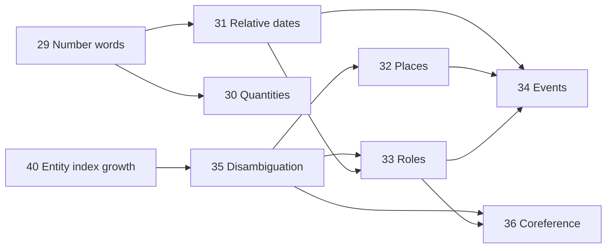

# Semantic expansion roadmap — tickets 29–36 and 40 (2026-11-19)

Scope: extend what `semantic-engine` **understands**. Nothing here renders,
searches providers or touches PipelineGen state. Semantic tickets add typed,
grounded facts to `semantic_manifest.v3`; TICKET-40 supplies the packaged
identity data needed to measure disambiguation. Planning and rendering stay in
Go / Chronon.

## What exists today (verified in code, 2026-11-19)

| Area | Current state | Where |
|---|---|---|
| Numbers | `NumericFact` kind `NUMBER`/`PERCENT`/`MONEY`/`FRACTION`; `form` is `digits`, `words` or `mixed`. ICU word scanning folds case, strips internal conjunctions, composes additive/multiplicative runs, resolves fractions and halves, includes approximators and rejects idioms; scale factors now cover es/pt/nl forms | `semantic-core/src/numbers.rs`, `semantic-core/src/number_words.rs`, `visualner/src/spellout.rs`, `lexicon/number_words.json` |
| Dates | `TemporalFact` (`day`/`month`/`year`/`unresolved`, BCE era, order-ambiguity flag); **absolute dates only** | `semantic-core/src/dates.rs` + `dates/*.rs` |
| Entities | `CanonicalIdentity` (PERSON, ORG, LOCATION, FACILITY, BRAND, PRODUCT…), `LinkedEntity` with `LinkStatus` linked/ambiguous/unlinked, gloss, `context_terms`/`counter_terms` in `entity_index_v1.json` | `identity.rs`, `entity_linker.rs` |
| Places | Toponyms are LOCATION entities; `location_cues.json`, `place_inflections.json` (pl/ru…). **No coordinates, no kind, no hierarchy, no routes** | `lexicon/` |
| Facts | `EntityFact` (predicate, value, unit, operator, status asserted/negated/uncertain) | `semantic-engine/src/facts.rs` |
| Relations | `AssertedRelation` ownership/funding/collaboration… | `semantic-core/src/relations.rs`, `lexicon/relation_cues.json` |
| Discourse | `discourse.v1`: references, threads, scene continuity; pronouns resolve only with one compatible antecedent | `semantic-engine/src/discourse/` |
| Groups | chronology, ranking, process, comparison, cause-effect, ordered sequences | `semantic-engine/src/groups.rs` |

## Tickets

| Ticket | Title | Depends on | Size |
|---|---|---|---|
| [29](TICKET-29-spoken-number-words.md) | Numbers written as words | — | M |
| [30](TICKET-30-typed-quantities.md) | Typed quantities with units, scale, year and comparison | 29 | L |
| [31](TICKET-31-relative-dates.md) | Relative dates anchored to a reference | 29 | M |
| [32](TICKET-32-places-and-routes.md) | Places with kind/coordinates/hierarchy and routes | 35 | L |
| [33](TICKET-33-person-roles.md) | People with role, affiliation, family and age | 31, 35 | L |
| [34](TICKET-34-events.md) | Event frames (type, participants, place, date) | 31, 32, 33 | L |
| [35](TICKET-35-entity-disambiguation.md) | Explainable entity disambiguation | 40 | M |
| [36](TICKET-36-coreference-pronouns.md) | Pronoun / role-nominal coreference | 33 (roles), 35 | M |

Recommended order: **40 → 35 → 32 → 33 → 36 → 34**, alongside the completed
29/31 sequence and the remaining TICKET-30 acceptance gates.
40 precedes 35 because the scorer needs a provenance-reviewed confusable seed;
then a wrong link ("Washington" the person vs the city) can be caught before
it poisons places, roles and events downstream.

## Invariants shared by every ticket (copy into each PR description)

1. **Grounded or absent.** Every emitted item carries `start_byte`/`end_byte`
   (UTF-8, exclusive end) and verbatim `evidence`. No span → no item.
2. **Fail closed.** Ambiguity yields `ambiguous`/`unresolved` with candidates,
   never a guess. Empty categories stay empty.
3. **Deterministic.** Same input → byte-identical output across runs and across
   `VISUALNER_WORKERS` values. Ties break by stable id, never by hash order.
4. **Additive schema.** New fields use `#[serde(default)]` and
   `skip_serializing_if`; `schema_version` stays `semantic_manifest.v3` unless a
   field changes meaning. Go consumer copy + goldens
   (`contract/`, `refactored/testdata/…`) updated in the same change.
5. **Cache safety.** Bump `AnalyzerVersions` for the touched analyzer so the
   fingerprint (and any manifest cache) invalidates.
6. **Data, not code, per language.** Vocabularies live in `lexicon/…` and are
   generated/checked by `lexicon/tools/build_language_packs.py --check`.
   No fixture-name or language-specific branches in Rust.
7. **Measured.** Each ticket ships a gold set (≥ 20 positive, ≥ 20 negative
   cases per capability, all 10 languages represented), a metric in
   `score_long_gold.py`, and the Pareto bar (≥ 90 % recall, 0 false positives
   on the negative set). Annotations authored by the agent are labelled
   `assistant_draft_pending_human_review` exactly as in TICKET-08.
8. **No external truth.** The manifest records what the text says. Coordinates
   and KB ids come from the packaged, versioned indexes; they are identity
   data, not a claim that the text is correct.
9. **Verification command** (with UDPipe models, ICU 72):
   `VISUALNER_MODEL_DIR=$PWD/.tmp/udpipe-models cargo test --workspace -j 2`
   plus `cargo fmt --all -- --check` and
   `cargo clippy --workspace --all-targets -- -D warnings`.

## Readiness audit — 2026-11-19

I ticket 30–36 non possono essere dichiarati CLOSED in questo checkout senza
inventare dati. Il motivo è verificabile nei file, non una stima:

| Ticket | Cosa manca davvero | Evidenza |
|---|---|---|
| 29 | **CLOSED 2026-11-19** | lessico, grammatica, frazioni/mezzi, 220+220 casi e gate di build |
| 30 | **PARTIAL 2026-11-21**; revisione umana indipendente e contesti positivi più vari | `lexicon/units.json` e pack generati, `Quantity` nel manifest, chart bridge; matrix draft: 1.784 casi, 1.643/1.643 quantità positive, 220 negativi quantitativi, 33 comparazioni incompatibili e 33 rapporti/differenze/change positivi, 0 falsi positivi; test Rust dimostra compatibilità fra ranking Top 10, quantità tipizzate e veto ai chart sui ranghi |
| 31 | **CLOSED 2026-11-19** | lessico 11 lingue, ancora esplicita/riferimento/narrativa, aritmetica civile, 231 casi gold |
| 32 | **PARTIAL 2026-11-21**; indice `place_index.v1` riproducibile con 195 paesi, 199 capitali, alias localizzati seeded per Warszawa/Mosca/Ankara e forme flesse pl/ru/tr linkate a coordinate con span esatto; cue roles/class nelle 11 lingue, waypoint e merge di hop tra scene consecutive same-person sono implementati; gold e geo-parent coherence generale restano | snapshot Wikidata CC0 + alias override hashed, 10 place + 9 route unit test, 2 protocol test; 35b migliora le collisioni non risolte dal seed |
| 33 | **PARTIAL 2026-11-21**; 40 role codes in English and Italian, grounded same-sentence extractor, exact byte spans and explicit date binding; numeric age facts require a grounded age form, spelled-out ages pass end-to-end in 11 languages, and birth-year derivation requires a dated-age construction; directional family/work relations use an 11-language enumerated seed; independent gold, broad inflection, Go parity and broader role coverage remain | `PersonRole`, `PersonAgeFact`, `PersonRelation`, `person_age_facts.v2.localized_dated_age`, all-language protocol acceptance and duration-negative test |
| 34 | **PARTIAL 2026-11-21**; all 12 core event types have trigger coverage in all 11 supported languages (agreement remains an extra legacy type); asserted cross-scene repeats merge only when a shared participant has a discourse thread spanning both scenes plus exact date/place, and overlapping entity facts are linked by ID; runtime tests cover id/pl/ru/tr plus localized negation and uncertainty; 200-frame cap | independently annotated natural gold, confusable-merge metrics and acceptance thresholds remain |
| 35 | Explainability/scoring | **PARTIAL 2026-11-21**; `link_candidates`/`link_margin`/`link_rule`, versioned weights, localized `type_cues` and a same-thread/same-type `discourse_prior` with exact evidence spans are implemented; natural 10-language gold and independent margin calibration remain. TICKET-40 is CLOSED |
| 36 | **PARTIAL 2026-11-21**; technical 440-case coref baseline now scores 440/440 status/target matches and zero false resolutions on draft labels; Turkish given-name coverage fixed a gold-detected missing antecedent; explicit role nominals use `resolution_basis=role_nominal`; structured pronoun/reference inventories cover 11 languages; independent gold, agreement breadth and salience margin remain | `coref_baseline.json`, `PersonRole.gender`, `discourse.v7.role_nominal_basis`, pronoun/name/role/reference-term inventory fingerprints wired |
| 40 | Crescita indice entity per gold ambiguo | **CLOSED 2026-11-19**; 86 righe, 46 superfici e 276+276 lookup, con provenance, collision report e check in CI |

Conseguenza operativa (aggiornata 2026-11-21): 29, 31 e 40 sono chiusi;
30 e 32–36 sono parziali; nessuno è OPEN. Restano i gate di gold indipendente per 30/35/36, il discourse prior e la
calibrazione per 35, le nove lingue e il gold per 33 (relazioni/età hanno uno
slice iniziale), e merge thread-aware e gold per 34. I ticket 08, 10 e 26 restano bloccati da
annotazioni, infrastruttura o credenziali esterne.

Piano operativo 2026-11-20 (terza passata): lo split dettagliato è nel
[README dei ticket](README.md#closure-plans-and-splits--2026-11-20). Sono
atterrati 32a–32d (slice iniziali), 33a–33d (slice iniziali), 34a–34c (slice
iniziali; ora i 12 tipi core sono coperti in tutte le 11 lingue), 35a, 36a (baseline draft), 36b e 36c (slice iniziale). Restano la
disambiguazione geo-parent e il gold 32e; il gold e
le nove lingue 33e; il merge thread-aware e il gold 34d;
35b/35c/35d; la validazione umana del gold 36 e il resolver 36d/36e; 30a.
**35b** migliora la disambiguazione di **32b**; **30b** richiede un revisore
umano indipendente.

## Out of scope for the whole series

Rendering/overlay design, provider search, currency conversion, fact-checking,
generative models inside Rust, and any Go-side planner decision. Go consumes the
new fields later under its own ticket.
